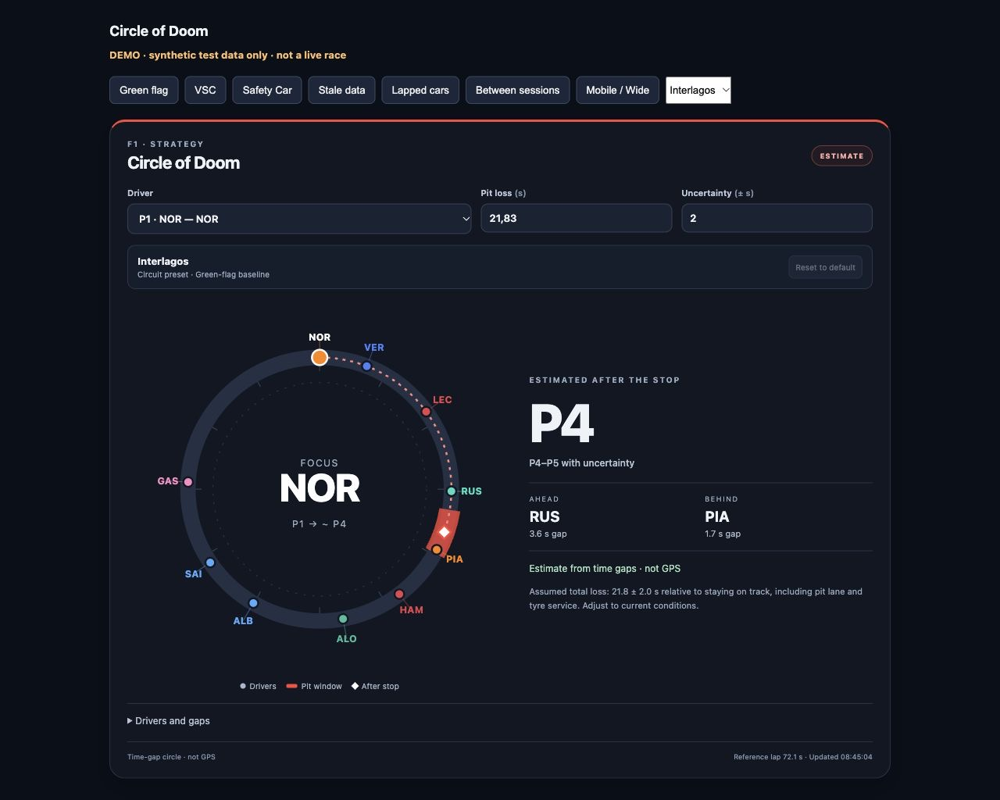

<p align="center">
  
</p>

# F1 Circle of Doom Card

A timing-based **pit-stop rejoin estimate** for Home Assistant and [F1 Sensor](https://github.com/Nicxe/f1_sensor). Public timing is enough — no F1TV subscription, account token, GPS feed or external JavaScript library required.

**v0.3.1 · Experimental.** This is a gap-based estimate, not a professional strategy system or a live track map. The interface is English.



## Features

- Compact driver codes directly above timing dots, with nearby collision lanes and selected-driver priority. No long callout lines.

- Driver selection via dropdown or circle marker, with team colours.
- Automatic circuit-specific pit-loss defaults for 25 circuits, with editable per-circuit values.
- Automatic VSC mode, shown only while VSC is active, with a separate editable loss.
- ± uncertainty window and a reset button for the active default.
- Estimated rejoin position and range, the gap + pit-loss calculation, and a preview of the reordered field.
- Lapped-car support using numeric intervals, including multiple laps and windows crossing the circle boundary.
- Separate estimated race order and nearest traffic on the wrapped time-gap circle.
- Collision-free label columns connected to exact timing markers, with a seconds scale and explicit clockwise gap direction.
- Responsive layout, keyboard-accessible controls and explicit waiting states.
- No invented positions: projection pauses when required data is missing or unreliable.
- MIT licensed. No trackers, telemetry, requests to third parties or HA service calls.

## Installation

### Manual

1. Install F1 Sensor (developed against **v6.2.0**) and enable live data plus **Driver positions**, **Current session**, **Session status** and **Track status** in its configuration. The modular F1 Sensor card can work even when these separate entities are disabled: this card specifically needs the entities.
2. Download [dist/f1-circle-of-doom-card.js](dist/f1-circle-of-doom-card.js) and copy it to `/config/www/f1-circle-of-doom-card.js` (some systems display this directory as `/homeassistant/www`).
3. Add a dashboard resource: URL `/local/f1-circle-of-doom-card.js?v=0.3.1`, type **JavaScript module**. Reload your dashboard.
4. Add a manual card using the configuration below. Replace the entity IDs with the actual IDs in your installation; older installations may use names such as `sensor.f1_drivers_driver_positions`.

### HACS / Marketplace custom repository

The repository contains a HACS manifest and a built JavaScript module in `dist`.
Add `https://github.com/maikelfuhrmann/ha-f1-circle-of-doom-card` as a custom **Dashboard** repository, then install it. This repository is not part of the default catalog. Manual installation and updates through the Home Assistant 2026.11 Marketplace are supported.

```yaml
type: custom:f1-circle-of-doom-card
title: Circle of Doom
entity: sensor.f1_driver_positions
session_entity: sensor.f1_current_session
session_status_entity: sensor.f1_session_status
track_status_entity: sensor.f1_track_status
auto_pit_loss: true
# Generic fallback when the circuit is unknown:
pit_loss: 22
vsc_pit_loss: 14.3
uncertainty: 2
stale_after: 90
```

All four entity settings are required. `driver: "4"` optionally sets the initial racing number. `reference_lap_seconds: 72` optionally overrides the reference lap; otherwise the card uses the median of the leader's last three recorded laps, requiring at least two valid samples. The override affects the circle scale and estimated circular traffic, never the recovered total gaps or projected race rank.

The card detects the circuit from the current-session or session-status attributes. Green defaults use published F1 race-preview estimates; see the [complete table and sources](docs/presets.md). **VSC defaults are approximate: 65% of each green baseline, not measured VSC data.** Adjust both to match conditions. Only the active mode's input is shown: **Pit loss** normally, **VSC pit loss** while track status is VSC. Returning to CLEAR restores the green value automatically.

Pit loss means total time lost relative to staying on track, including pit-lane transit and tyre service. **Reset to default** restores only the current circuit and condition. Your changes persist separately for each circuit and condition in this browser/app, scoped to the configured sensor IDs. They are not synchronized across devices. Cards with the same sensors share saved settings on reload; set a distinct `storage_key: my_card` to isolate a card. If storage is unavailable, the card says that changes are temporary. Uncertainty remains a temporary control; save its YAML default for persistence.

Unknown circuits use the clearly labelled `pit_loss` / `vsc_pit_loss` fallback (22 / 14.3 seconds by default). They never reuse a different track's value. Optional `circuit: Interlagos` overrides detection when metadata is missing; omit it for automatic switching. Set `auto_pit_loss: false` to use YAML defaults at every circuit. Existing saved manual values still take precedence until reset.

## Reading the circle

The leader is fixed at twelve o'clock. Increasing time gaps run clockwise; one full circle represents the reference lap. Markers show **relative time gaps**, not physical track coordinates or interpolated movement.

Lapped vehicles retain their complete time deficit for race classification. When the feed replaces seconds with `1 L`, `+1 LAP` or `2 LAPS`, the card recovers the deficit from the preceding classified driver's known gap plus the numeric `interval_to_position_ahead`, chaining only consecutive positions. It never multiplies a lap label by a reference lap to invent a gap. Recovered values are identified in the details.

The circle wraps each total gap around the reference lap. `+1L` / `+2L` beside a driver is the feed's reported lap deficit. **Ahead/behind on circle** estimates nearby traffic after the stop, including cars on different laps; **race order** uses the full gaps. Circular spacing is an approximation based on a common reference lap, not actual GPS spacing. Changes in pace, old individual fields and mixed timing updates limit its accuracy.

The selected driver's gap plus the chosen pit loss is the estimated rejoin gap. The red arc is the ± uncertainty window; the white diamond is its centre. The position range is a scenario range, not a statistical confidence interval. Competitors tied at a boundary are conservatively counted ahead.

Under VSC, the result is explicitly a **scenario estimate**, assuming VSC remains active for the entire stop. VSC transitions and changing deltas can invalidate it; the same data-quality guards still apply.

Assumptions: all other drivers stay on track and keep their current relative pace; no traffic, tyre warm-up, penalties, double stacking or rival pit stops are modelled. Session delay is inherited from F1 Sensor's entity updates. The card does not add its own delay.

### When the projection pauses

- Outside live Race or Sprint sessions, or during yellow, red or SC conditions.
- Unavailable sensors, missing timestamps, data older than `stale_after` seconds, or clocks more than ten seconds in the future.
- Missing gaps, inconsistent order, duplicate drivers, fewer than two active drivers, or insufficient reference lap samples.
- Any active driver in the pits, exiting the pits or stopped. This intentionally suppresses estimates during changing pit-cycle order.
- A missing numeric gap that cannot be recovered through an uninterrupted numeric interval chain. A lap label alone does not provide precise timing.

Freshness uses the timing entity's `last_reported` when present, otherwise `last_updated`. This checks the entity timestamp, not each individual upstream field. F1 Sensor may retain some values; the underlying feed is not guaranteed complete. The leader’s `Lap N` counter is treated as race progress, not a lap deficit. Explicit deficits such as `1 L` and `+1 LAP` identify lapped cars; unresolved gaps still pause the prediction. Regression tests cover the live-feed label format alongside synthetic strategy scenarios.

## Development

Node.js 20+ and Python 3 (preview server only); no npm dependencies.

```sh
npm run check       # model tests, reproducible build, JS syntax
npm run preview     # http://127.0.0.1:8766/examples/preview.html
```

The preview is a separate page using explicitly labelled synthetic data. It is never used as a fallback in Home Assistant. `src/presets.js` contains circuit defaults and selection; `src/model.js` contains the pure calculation; `src/card.js` renders the custom element. `npm run build` generates the standalone distribution file. CI checks that committed output matches the source.

## Project logo

The original project logo is included in [brand/](https://github.com/maikelfuhrmann/ha-f1-circle-of-doom-card/tree/main/brand), and appears here and on the Marketplace repository detail page. The Marketplace currently uses a fixed category symbol for dashboard cards in its list; custom list icons are supported only for integrations. See [branding notes](docs/branding.md).

## Support this project

If this card is useful to you, you can [buy me a coffee via PayPal](https://paypal.me/maikeltimo). Donations are optional; all features stay free.

## Sources and independence

- [F1 Sensor driver timing schema](https://nicxe.github.io/f1_sensor/entities/driver-positions)
- [Public live data availability](https://nicxe.github.io/f1_sensor/entities/live-data)
- [Home Assistant custom cards](https://contributors.home-assistant.io/frontend/custom-ui/card/)

Independent community project, not affiliated with Formula 1, the FIA, any team, Home Assistant, or F1 Sensor. No official marks, broadcast graphics, audio or video are distributed. MIT license covers this project's code, not third-party data.
